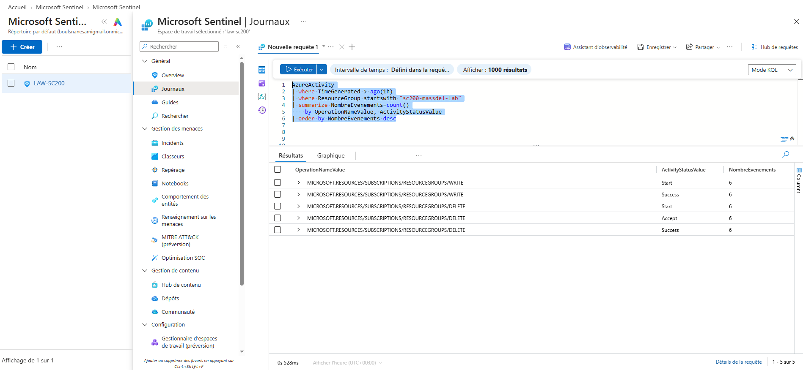

# Simulation — Suppression massive de groupes de ressources Azure

## Objectif

L'objectif de cette étape est de générer de manière contrôlée plusieurs opérations de suppression dans le plan de gestion Azure afin de produire des événements exploitables dans Microsoft Sentinel.

## Principe

Six groupes de ressources Azure vides sont créés spécifiquement pour le laboratoire :

```text
sc200-massdel-lab-1
sc200-massdel-lab-2
sc200-massdel-lab-3
sc200-massdel-lab-4
sc200-massdel-lab-5
sc200-massdel-lab-6
```

Une fois leur création terminée, les six groupes sont supprimés rapidement via Azure CLI.

Aucune ressource existante hors du laboratoire n'est ciblée.

## Garde-fous

Le script utilise le préfixe spécifique :

```text
sc200-massdel-lab
```

Les opérations de suppression ne concernent que les groupes créés pour le laboratoire.

Une confirmation manuelle est également demandée avant le lancement des suppressions.

## Script

Le script utilisé pour générer l'activité est disponible dans :

```text
scripts/simulate-mass-deletion.sh
```

## Source de données

Les opérations de gestion Azure sont ingérées dans Microsoft Sentinel dans la table :

```kusto
AzureActivity
```

La présence des événements est vérifiée avec :

```kusto
AzureActivity
| where TimeGenerated > ago(2h)
| where ResourceGroup startswith "sc200-massdel-lab"
| project
    TimeGenerated,
    ResourceGroup,
    OperationNameValue,
    ActivityStatusValue
| order by TimeGenerated asc
```

## Événements observés

Les valeurs `OperationNameValue` observées pendant le scénario sont :

```text
MICROSOFT.RESOURCES/SUBSCRIPTIONS/RESOURCEGROUPS/WRITE
MICROSOFT.RESOURCES/SUBSCRIPTIONS/RESOURCEGROUPS/DELETE
```

Pour une même suppression, Azure Activity Log peut générer plusieurs états :

```text
Start
Accept
Success
```

Afin d'éviter de compter plusieurs fois une même suppression dans une détection, les requêtes de détection privilégient les événements dont :

```kusto
ActivityStatusValue =~ "Success"
```

L'opération de suppression d'un groupe de ressources est identifiée avec :

```kusto
OperationNameValue =~ "MICROSOFT.RESOURCES/SUBSCRIPTIONS/RESOURCEGROUPS/DELETE"
```

## Résultat

La simulation a généré avec succès :

- 6 créations de groupes de ressources ;
- 6 suppressions de groupes de ressources ;
- les événements associés dans `AzureActivity`.

Les six groupes de ressources du laboratoire ont pu être identifiés individuellement dans les journaux.

Cette étape valide la chaîne suivante :

```text
Azure CLI
    ↓
Azure Resource Manager
    ↓
Azure Activity Log
    ↓
Log Analytics
    ↓
Microsoft Sentinel
```

