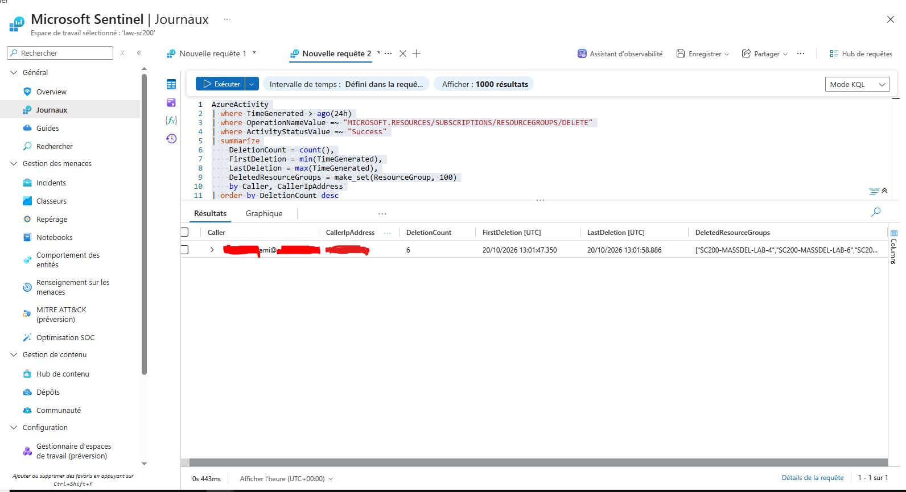
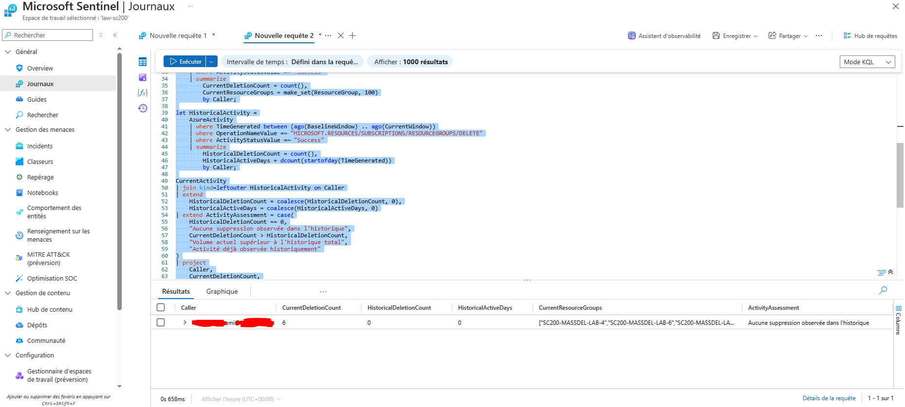

# Threat Hunting — Suppressions massives de groupes de ressources Azure

## Objectif

Cette étape consiste à exploiter les événements collectés dans `AzureActivity` afin d'identifier et d'investiguer une activité de suppression inhabituelle de groupes de ressources Azure.

Trois requêtes KQL ont été développées :

1. identification des suppressions par identité ;
2. reconstruction de la chronologie des suppressions ;
3. comparaison de l'activité actuelle avec l'historique disponible.

Les requêtes sont disponibles dans le dossier :

```text
queries/
├── 01-deletions-by-identity.kql
├── 02-deletion-timeline.kql
└── 03-deletion-baseline-comparison.kql
```

---

## 1. Identification des suppressions par identité

La première requête recherche les suppressions de groupes de ressources terminées avec succès au cours des dernières 24 heures.

```kusto
AzureActivity
| where TimeGenerated > ago(24h)
| where OperationNameValue =~ "MICROSOFT.RESOURCES/SUBSCRIPTIONS/RESOURCEGROUPS/DELETE"
| where ActivityStatusValue =~ "Success"
| summarize
    DeletionCount = count(),
    FirstDeletion = min(TimeGenerated),
    LastDeletion = max(TimeGenerated),
    DeletedResourceGroups = make_set(ResourceGroup, 100)
    by Caller, CallerIpAddress
| order by DeletionCount desc
```

Cette requête permet d'identifier :

- l'identité à l'origine des suppressions ;
- l'adresse IP source ;
- le nombre de suppressions ;
- la première suppression observée ;
- la dernière suppression observée ;
- les groupes de ressources concernés.

### Résultat observé

La simulation a produit :

```text
DeletionCount = 6
```

Les six groupes de ressources du laboratoire ont été supprimés par la même identité dans une fenêtre temporelle très courte.

Ce regroupement permet de transformer plusieurs événements Azure individuels en une activité cohérente pouvant être analysée par un SOC.



---

## 2. Reconstruction de la chronologie

La deuxième requête conserve les différents états associés aux opérations de suppression :

```text
Start
Accept
Success
```

La requête utilisée est :

```kusto
AzureActivity
| where TimeGenerated > ago(24h)
| where OperationNameValue =~ "MICROSOFT.RESOURCES/SUBSCRIPTIONS/RESOURCEGROUPS/DELETE"
| where ActivityStatusValue in~ ("Start", "Accept", "Success")
| project
    TimeGenerated,
    Caller,
    CallerIpAddress,
    ResourceGroup,
    ActivityStatusValue,
    CorrelationId
| order by TimeGenerated asc
```

Contrairement à une règle de détection, l'objectif n'est pas ici de compter les suppressions mais de reconstruire leur déroulement.

Le `CorrelationId` peut notamment être utilisé pendant une investigation afin de rapprocher les différents événements appartenant à une même opération Azure.

---

## 3. Éviter le double comptage

Une opération de suppression peut générer plusieurs événements dans Azure Activity Log.

Par exemple :

```text
DELETE → Start
DELETE → Accept
DELETE → Success
```

Compter directement tous les événements `DELETE` pourrait donc produire plusieurs occurrences pour une seule suppression réelle.

Pour les requêtes de détection et d'agrégation, seules les opérations terminées avec succès sont retenues :

```kusto
| where ActivityStatusValue =~ "Success"
```

Cette distinction permet d'utiliser :

- les événements `Success` pour la détection et le comptage ;
- les différents états pour l'investigation et la reconstruction de la chronologie.

---

## 4. Comparaison avec l'historique

Une troisième requête compare l'activité récente avec les suppressions précédemment observées pour la même identité.

La fenêtre actuelle utilisée est :

```text
1 heure
```

La période historique utilisée est :

```text
7 jours
```

La requête est disponible dans :

```text
queries/03-deletion-baseline-comparison.kql
```

Elle compare notamment :

```text
CurrentDeletionCount
HistoricalDeletionCount
HistoricalActiveDays
```

### Résultat observé

Lors de l'exécution du laboratoire :

```text
CurrentDeletionCount     = 6
HistoricalDeletionCount  = 0
HistoricalActiveDays     = 0
```

L'évaluation générée par la requête est :

```text
Aucune suppression observée dans l'historique
```

Les six suppressions constituent donc une activité nouvelle par rapport à l'historique disponible dans le workspace.



---

## 5. Limite de la baseline

Cette comparaison constitue une démonstration de threat hunting et non une baseline comportementale de production.

Le workspace utilisé pour le laboratoire possède un historique limité. Une absence de suppression pendant les sept jours précédents ne suffit donc pas, à elle seule, à démontrer qu'une activité est malveillante.

Dans un environnement de production, l'analyse pourrait être enrichie avec :

- un historique plus long ;
- le rôle et les privilèges de l'identité ;
- les groupes de ressources habituellement administrés ;
- l'adresse IP source ;
- les horaires habituels d'activité ;
- d'autres événements Azure associés à la même identité.

---

## 6. Conclusion du Threat Hunting

L'analyse KQL permet d'établir les éléments suivants :

```text
6 suppressions réussies
        ↓
même identité
        ↓
fenêtre temporelle très courte
        ↓
aucune suppression observée dans l'historique disponible
        ↓
activité suffisamment inhabituelle pour justifier une détection
```

Ces résultats servent de base à l'étape suivante du laboratoire : la création d'une règle analytique Microsoft Sentinel capable de détecter automatiquement une suppression massive de groupes de ressources Azure.
