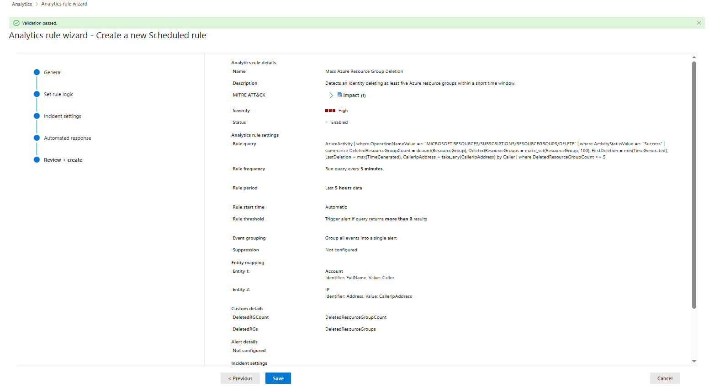
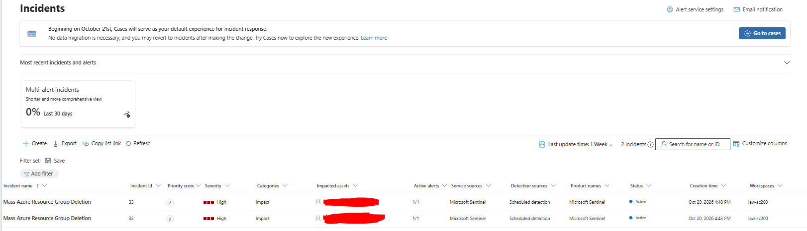
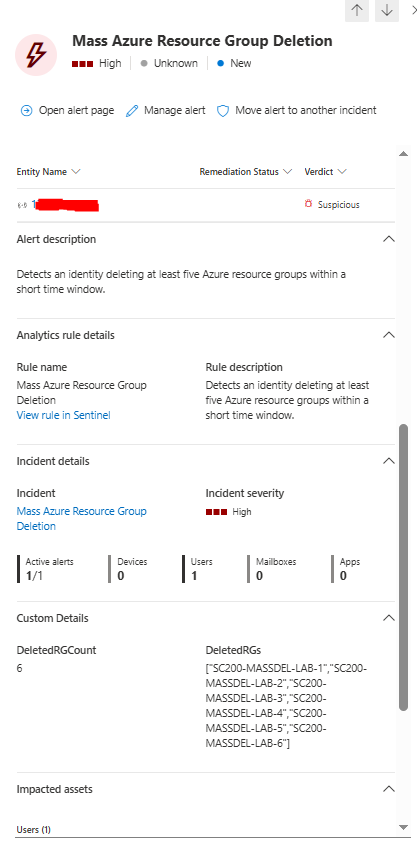

# Règle de détection — Suppression massive de groupes de ressources Azure

## Objectif

Cette étape transforme les requêtes de threat hunting développées précédemment en une règle analytique Microsoft Sentinel capable de générer automatiquement une alerte lorsqu'une identité supprime plusieurs groupes de ressources Azure dans une fenêtre temporelle courte.

L'objectif est de détecter un comportement potentiellement destructif pouvant correspondre à la technique MITRE ATT&CK :

```text
T1485 — Data Destruction
```

La tactique associée est :

```text
Impact
```

---

## Nom de la règle

```text
Mass Azure Resource Group Deletion
```

## Sévérité

```text
High
```

La suppression simultanée de plusieurs groupes de ressources peut entraîner la disparition de ressources, services ou configurations critiques.

---

## Logique de détection

La règle utilise les événements de la table :

```kusto
AzureActivity
```

Seules les opérations de suppression de groupes de ressources terminées avec succès sont prises en compte :

```kusto
OperationNameValue =~ "MICROSOFT.RESOURCES/SUBSCRIPTIONS/RESOURCEGROUPS/DELETE"
```

et :

```kusto
ActivityStatusValue =~ "Success"
```

La règle agrège ensuite les suppressions par identité.

La requête utilisée est :

```kusto
AzureActivity
| where OperationNameValue =~ "MICROSOFT.RESOURCES/SUBSCRIPTIONS/RESOURCEGROUPS/DELETE"
| where ActivityStatusValue =~ "Success"
| summarize
    DeletedResourceGroupCount = dcount(ResourceGroup),
    DeletedResourceGroups = make_set(ResourceGroup, 100),
    FirstDeletion = min(TimeGenerated),
    LastDeletion = max(TimeGenerated),
    CallerIpAddress = take_any(CallerIpAddress)
    by Caller
| where DeletedResourceGroupCount >= 5
```

---

## Pourquoi utiliser `dcount(ResourceGroup)` ?

La détection ne cherche pas simplement cinq événements de suppression.

Elle cherche :

```text
5 groupes de ressources distincts supprimés
```

L'utilisation de :

```kusto
dcount(ResourceGroup)
```

évite qu'un même groupe de ressources soit comptabilisé plusieurs fois.

Le seuil retenu pour le laboratoire est :

```text
DeletedResourceGroupCount >= 5
```

---

## Planification

La règle a été configurée avec :

```text
Run query every : 5 minutes
Lookup data from the last : 5 heures
```

La fenêtre de cinq heures a volontairement été conservée pendant le laboratoire afin d'inclure les événements déjà générés lors de la simulation et de faciliter la validation de la règle.

Dans un environnement de production, cette fenêtre pourrait être réduite selon les besoins opérationnels, par exemple à 10 ou 15 minutes.

---

## Déclenchement de l'alerte

Le seuil de cinq suppressions est directement implémenté dans la requête KQL :

```kusto
| where DeletedResourceGroupCount >= 5
```

La règle Sentinel est donc configurée pour générer une alerte lorsque la requête retourne au moins une ligne :

```text
Trigger when number of query results > 0
```

Une ligne retournée représente une identité ayant déjà dépassé le seuil défini.

---

## Groupement des événements

La configuration utilise :

```text
Group all events into a single alert
```

Le comportement attendu est donc :

```text
plusieurs événements AzureActivity
        ↓
agrégation KQL
        ↓
1 résultat par identité
        ↓
1 alerte Sentinel
        ↓
1 incident Sentinel
```

---

## Entity Mapping

Les résultats de la requête sont associés à des entités Sentinel.

### Compte

```text
Entity type : Account
Identifier  : FullName
Column      : Caller
```

### Adresse IP

```text
Entity type : IP
Identifier  : Address
Column      : CallerIpAddress
```

Ces mappings permettent à Sentinel de rattacher directement l'identité et l'adresse IP à l'alerte et à l'incident.

---

## Custom Details

Deux informations sont ajoutées à l'alerte :

```text
DeletedRGCount
→ DeletedResourceGroupCount
```

et :

```text
DeletedRGs
→ DeletedResourceGroups
```

Elles permettent à l'analyste de visualiser immédiatement :

- le nombre de groupes de ressources supprimés ;
- la liste des groupes concernés.

---

## MITRE ATT&CK

La règle est associée à :

```text
Tactic    : Impact
Technique : T1485 — Data Destruction
```

Cette technique correspond à une activité de destruction de données ou de ressources pouvant impacter la disponibilité ou les opérations d'un système.

---

## Résultat observé

La simulation précédente avait généré six suppressions de groupes de ressources.

La règle analytique a détecté :

```text
DeletedRGCount = 6
```

avec les groupes suivants :

```text
SC200-MASSDEL-LAB-1
SC200-MASSDEL-LAB-2
SC200-MASSDEL-LAB-3
SC200-MASSDEL-LAB-4
SC200-MASSDEL-LAB-5
SC200-MASSDEL-LAB-6
```

La règle a ensuite généré automatiquement :

```text
1 alerte High
        ↓
1 incident Microsoft Sentinel
```

L'incident contient notamment :

- l'identité associée ;
- l'adresse IP source ;
- le nombre de suppressions ;
- la liste des groupes de ressources supprimés.

---

## Export de la règle

La règle déployée dans Microsoft Sentinel a été exportée directement depuis Sentinel au format JSON.

Le fichier est disponible dans :

```text
rules/mass-deletion-rule.json
```

Cet export correspond à la règle effectivement configurée et testée dans Sentinel.

L'export contient notamment :

- la requête KQL ;
- la fréquence d'exécution ;
- la période de recherche ;
- le seuil de déclenchement ;
- la sévérité ;
- la tactique MITRE ATT&CK ;
- la technique `T1485` ;
- les Entity Mappings ;
- les Custom Details ;
- la configuration de création d'incident.

---

## Captures

### Configuration de la règle



### Incident généré



### Entités et détails personnalisés



---

## Chaîne de détection validée

La chaîne complète observée pendant le laboratoire est :

```text
Azure CLI
        ↓
Suppression de 6 groupes de ressources
        ↓
Azure Resource Manager
        ↓
Azure Activity Log
        ↓
Log Analytics
        ↓
Microsoft Sentinel
        ↓
Règle analytique Scheduled
        ↓
Agrégation par identité
        ↓
Seuil >= 5 groupes supprimés
        ↓
Alerte High
        ↓
Incident Microsoft Sentinel
```

---

## Conclusion

Cette étape valide le passage d'une activité de threat hunting manuelle à une détection automatisée exploitable par un SOC.

La règle permet de détecter automatiquement une suppression massive de groupes de ressources Azure, d'identifier l'identité et l'adresse IP associées, puis de générer un incident contenant les informations nécessaires à une première investigation.

L'étape suivante consiste à enrichir cette chaîne avec une réponse automatisée via une Automation Rule et un playbook Logic App.
