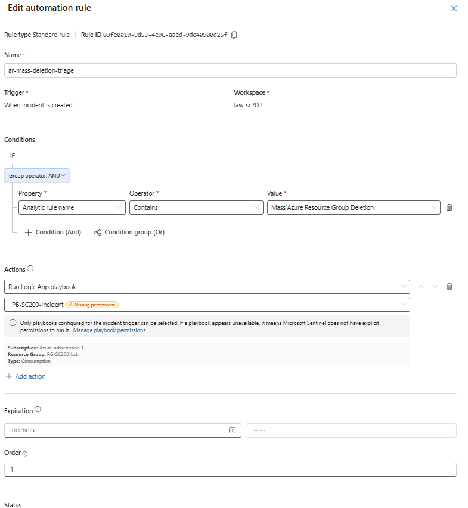
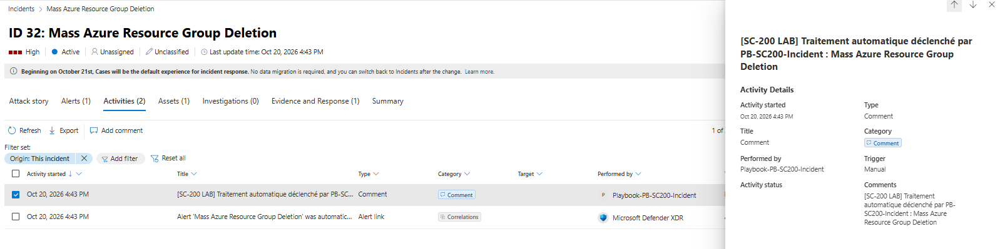

# Automatisation SOAR — Enrichissement automatique des incidents

## Objectif

Cette étape ajoute une couche d'automatisation à la chaîne de détection Microsoft Sentinel.

Lorsqu'un incident issu de la règle analytique :

```text
Mass Azure Resource Group Deletion
```

est créé, une Automation Rule est utilisée pour déclencher un playbook Logic App chargé d'enrichir l'incident avec un commentaire destiné à faciliter le triage par un analyste SOC.

L'objectif est d'obtenir la chaîne suivante :

```text
Détection KQL
        ↓
Alerte Sentinel
        ↓
Incident
        ↓
Automation Rule
        ↓
Playbook Logic App
        ↓
Ajout automatique d'un commentaire
```

---

## Réutilisation d'un playbook existant

Un playbook Microsoft Sentinel existant a été réutilisé :

```text
PB-SC200-Incident
```

Ce playbook avait déjà été conçu pour traiter un incident Sentinel et ajouter automatiquement un commentaire dans son activité.

La réutilisation d'un playbook existant évite de dupliquer une Logic App réalisant la même fonction.

Dans un environnement SOC réel, ce type de composant réutilisable permet de centraliser certaines actions communes de triage ou d'enrichissement.

---

## Automation Rule

Une Automation Rule dédiée a été créée :

```text
ar-mass-deletion-triage
```

### Déclencheur

```text
When incident is created
```

La règle s'exécute lorsqu'un nouvel incident Sentinel est créé.

### Condition

L'automatisation est limitée aux incidents provenant de la règle analytique :

```text
Mass Azure Resource Group Deletion
```

La condition configurée est basée sur :

```text
Analytic rule name
Contains
Mass Azure Resource Group Deletion
```

Cette condition évite de lancer le playbook sur tous les incidents du workspace.

### Action

L'action configurée est :

```text
Run Logic App playbook
```

avec le playbook :

```text
PB-SC200-Incident
```

L'architecture obtenue est donc :

```text
Incident créé
        ↓
Vérification de la règle analytique source
        ↓
Mass Azure Resource Group Deletion
        ↓
PB-SC200-Incident
        ↓
Enrichissement de l'incident
```

---

## Fonction du playbook

Le playbook ajoute un commentaire dans l'incident afin de signaler qu'un traitement automatique a été effectué.

Un exemple observé pendant le laboratoire est :

```text
[SC-200 LAB] Traitement automatique déclenché par PB-SC200-Incident :
Mass Azure Resource Group Deletion
```

Ce commentaire apparaît directement dans les activités de l'incident.

Il permet à un analyste de voir rapidement qu'un composant d'automatisation SOC a traité l'incident.

---

## Intérêt opérationnel

Sans automatisation, un analyste doit ouvrir chaque incident et effectuer manuellement les premières actions de triage.

Avec le playbook :

```text
Incident
    ↓
Traitement automatique
    ↓
Commentaire ajouté
    ↓
Analyste informé
```

Cette première automatisation reste volontairement simple.

Dans un environnement de production, le même mécanisme pourrait être étendu pour :

- enrichir une adresse IP avec des données de Threat Intelligence ;
- rechercher l'activité récente du compte concerné ;
- notifier une équipe SOC ;
- ouvrir un ticket dans un outil ITSM ;
- modifier le statut ou le propriétaire d'un incident ;
- déclencher une action de remédiation après validation.

---

## Capture de l'Automation Rule

La configuration de l'Automation Rule montre :

- le déclencheur à la création d'un incident ;
- la condition sur la règle analytique ;
- l'exécution du playbook `PB-SC200-Incident`.



---

## Validation du playbook

Le fonctionnement du playbook a été validé par l'ajout d'un commentaire dans un incident :

```text
Mass Azure Resource Group Deletion
```

L'activité Sentinel identifie :

```text
Performed by:
Playbook-PB-SC200-Incident
```

et le commentaire ajouté par le playbook est visible directement dans l'historique de l'incident.



---

## Chaîne SOC obtenue

Le laboratoire combine désormais détection et automatisation :

```text
Azure Activity Log
        ↓
Log Analytics
        ↓
Microsoft Sentinel
        ↓
Règle analytique Scheduled
        ↓
Détection de >= 5 suppressions
        ↓
Incident High
        ↓
Automation Rule
        ↓
PB-SC200-Incident
        ↓
Enrichissement de l'incident
```

---

## Conclusion

Cette étape démontre l'intégration d'une logique SOAR dans le scénario de détection.

La chaîne ne se limite plus à générer une alerte : un playbook Logic App peut être associé au scénario afin d'automatiser les premières actions de traitement d'un incident.

La réutilisation du playbook `PB-SC200-Incident` permet également de montrer qu'un même composant d'automatisation peut être intégré à différents scénarios de détection sans devoir recréer toute la logique.
